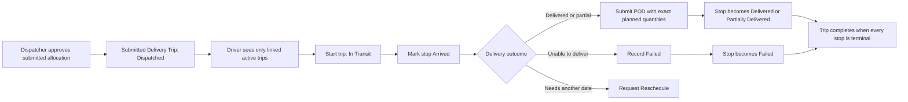
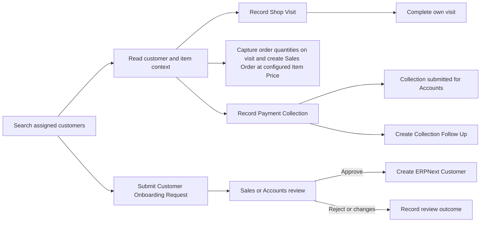
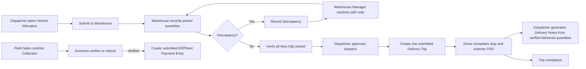

# KEERTHI VMS role workflow audit

Date: 2026-11-01  
Scope: VMS API modules, workflow DocType controllers, and the Driver, Field Sales, Warehouse, Dispatch, Accounts, and Fleet handoffs. The running `frontend` Docker site was not used. Verification ran on the isolated `vms-api-test.local` Frappe v16 site.

## Workflow maps

### Driver



The driver identity is resolved through `Driver.user_id`; trip reads and mutations check assignment. POD validation binds the stop, customer, and item quantities to server-side trip allocations, rejects duplicate submitted PODs, forbids cash/COD, and seals evidence. Driver access to payment APIs is explicitly denied.

### Field Sales Agent



**Sales Agent access:** assign the `Field Sales Agent` role. The Desk entry is **Field Sales**. It opens “Sales Visit & Order Capture” (Shop Visit) and “My Sales Orders”. Each visit item has an Order Quantity; the Actions menu creates an ERPNext draft Sales Order using the server's Item Price. The role receives owner-scoped Sales Order read/write/create access only; it cannot submit orders. `Sales Manager` can review and submit.

The role-gated Field Sales API surface is `search_customers`, `get_assigned_customers`, `get_customer_context`, `get_item_context`, `create_shop_visit`, `complete_shop_visit`, `create_sales_order`, and `get_my_sales_orders`. Driver endpoints are `get_my_trips`, `get_trip_details`, `start_trip`, `record_arrival`, `submit_pod`, `record_failed_delivery`, and `request_reschedule`. Drivers are blocked from Field Sales and payment APIs. The separate `Driver` role uses the mobile driver portal API, with assigned-trip scoping; it is not given the Field Sales workspace. Assign `Driver` only to driver accounts and `Field Sales Agent` only to sales accounts (via User > Roles); Sales Managers supervise orders and collections.

Field Sales access is constrained by User Permissions/territory and Customer read permission. Item prices now come from Item Price; client rates are ignored. Collections require an in-scope readable customer and submit through Payment Collection validation. Drivers cannot use Field Sales/payment operations, including where role combinations exist.

### Internal operations and finance



Warehouse operations require submitted allocations and warehouse read permission. Discrepancies prevent loading verification until resolved. Accounts cannot verify their own Field Sales collection; Payment Entry creation requires Verified status, checks invoice/customer/company/outstanding balances, and stores the resulting ERPNext reference.

Fleet endpoints provide vehicle/driver availability and operational status. The Fleet Manager/Dispatcher roles can manage masters; status views are role-gated.

## Findings addressed

| Severity | Finding | Change |
|---|---|---|
| High | Sales Order API accepted client-supplied item rates. | Always resolves the configured Item Price; rejects missing/non-positive prices and invalid/non-positive quantities. |
| High | Payment Collection creation did not enforce customer scope/read permission at the API boundary. | Added both checks before creating the collection. The DocType controller continues to enforce them as a second boundary. |
| High | Concurrent dispatch approvals could both see `Loading Verified` and create separate trips for one allocation. | Lock and reload the allocation before approval; return the already-linked non-cancelled trip on a repeated request. |
| High | Concurrent POD submissions could both pass the duplicate check for one stop. | Lock the Delivery Trip Stop before checking for a submitted POD. |
| Medium | Driver trip start did not check trip submission/state, and terminal stops could be reopened by arrival. | Restrict to submitted Dispatched/In Transit trips; only Pending stops can newly arrive. Repeated start/arrival is idempotent. |
| Medium | Optional GPS handling ignored zero coordinates and accepted invalid pairs in several flows. | Added shared pair, numeric, finite, and range validation; applied it to Driver arrival/POD and Shop Visit/POD DocType validation. |
| Medium | Internal queue counts included draft allocations/collections. | Queue counts now filter `docstatus = 1`. |
| Medium | Fleet monitoring omitted `Discrepancy Reported` and `Dispatched` allocations, making an on-road vehicle look available. | Fleet status now uses the full active-allocation status set. |
| Medium | Vehicle Allocation validation read `Vehicle.status`, which is not part of ERPNext v16 Vehicle schema and caused an SQL unknown-column error while saving drafts. | Availability checks now use optional status/disabled fields only when the installed schema defines them; standard Vehicle records no longer trigger an invalid column read. |
| Medium | Field Sales customer context dereferenced a site-specific `Customer.custom_credit_limit` field absent from the installed schema. | It now reads the standard Customer Credit Limit child rows for the user's active company and returns zero when none is configured. |
| Medium | Shop Visit completion overwrote the API success result and did not persist visit state. | Added the Visit Status field and returns separate `status: success` and `visit_status: Completed` values. |
| High | Field Sales Agents had no Sales Order create permission, the Shop Visit item had no order quantity, and its “Create Sales Order” button called the API with the wrong mapped-document contract. | Added an idempotent VMS migration hook for owner-scoped Sales Order read/write/create (no submit), an Order Quantity child field, and a direct API call that opens the returned draft order. |
| Low | POD records stored photo attachments without an immediately visible evidence gallery. | Added a responsive, safe-rendered thumbnail gallery to the form, with category/remarks captions. |
| Medium | POD Desk form required operators to manually copy trip stop, customer, and item allocations. | Added an authorized “Auto-fill from Delivery Trip” action. Full-delivery quantities are prefilled only after explicit confirmation; recorded arrival GPS is copied when present. Server timestamp and SHA-256 seal remain server-generated. |
| Low | VMS workspaces had large empty areas and no charts. | Added role-appropriate charts to all seven workspaces and theme-aware card/chart styling. |
| Low | Dashboard test paths referenced the wrong app-relative locations. | Fixed the paths to resolve from the installed app root. |
| High | Docker frontend returned 404 for VMS CSS, JS, and logo assets because the frontend image lacked the VMS asset symlink. | Bake `bench build --app vms` and the public asset symlink into the image; verified all three frontend URLs return 200. |

## Open workflow gaps and limits

1. **Reschedule handoff is incomplete.** Driver API records `Rescheduled` plus requested date/reason, but there is no internal queue/review endpoint or documented action to replan that customer stop. `DeliveryTrip.check_completion()` also does not treat Rescheduled as terminal, so that trip remains incomplete. Decide whether rescheduling should close the current stop and create a follow-up allocation, or be reviewed and reset on the same trip, then implement the matching staff action.
2. **Dashboard company filtering is partial.** `get_dashboard_summary(company=...)` conditionally filters trip counts, but allocation, collection, and discrepancy counts remain global. If the site uses more than one company, the response can mix companies. Scope all returned metrics consistently or remove the company parameter until supported.
3. **The suite is not a full business-data integration run.** Seventeen new API-flow regression tests exercise installed app functions with controlled/mocked records; 45 older tests pass, but a number of them are synthetic logic assertions. The suite does not yet build complete ERPNext fixtures and drive every HTTP API over HTTP as Driver, Field Sales, Warehouse, Dispatch, and Accounts users. The 23 targeted workflow/API checks are focused regressions, not a claim that every endpoint has full business-data end-to-end coverage. A temporary isolated user with only `Field Sales Agent` was also verified to have Sales Order create/read permissions but no submit permission.
4. **No API was exercised against the live Docker `frontend` site.** The test stack is isolated, and the current Docker image is separate from this workspace source. The code fixes here have not been deployed to that running site.

## Verification

Command run against isolated test site:

```text
bench --site vms-api-test.local run-tests --app vms
```

The final candidate migration completed on the isolated `vms-api-test.local` site. Result: **23 focused workflow/API regression tests passed**, including endpoint inventory, Shop Visit completion, Vehicle v16 schema compatibility, standard Customer Credit Limit handling, and the owner-scoped Sales Order permission check. The test site is separate from production. All seven Workspace chart links and the POD gallery field were confirmed registered after migration.

The preserved Docker candidate also passed its isolated Frappe migration. Its default suite ran 61 standard tests successfully, then the runner stopped before the API-flow category because a legacy test module in the base image requests the unavailable `Payment Gateway` DocType during fixture preparation. The 17 API-flow tests passed separately against the installed source runner. This is a test harness limitation; it does not indicate a migration or runtime import failure.

## VMS document IDs

Saved VMS records already use readable prefix/year/sequence naming: Shop Visit `VISIT-.YYYY.-.#####`, Delivery Trip `TRIP-.YYYY.-.#####`, Proof of Delivery `POD-.YYYY.-.#####`, Vehicle Allocation `VA-.YYYY.-.#####`, Payment Collection `PAY-COL-.YYYY.-.#####`, Payment Discrepancy `PAY-DISC-.YYYY.-.#####`, Warehouse Discrepancy `WHD-.YYYY.-.#####`, Customer Onboarding `ONBOARD-.YYYY.-.#####`, and Collection Follow Up `CFU-.YYYY.-.#####`. The `new-...` value shown while composing a new form is a temporary unsaved browser ID; it is replaced with the configured sequence after save. Existing naming patterns and saved document IDs were preserved.

## Deployment

Deployed to the existing Docker Compose site `frontend` on 2026-11-01. The live Vehicle `KL-TEST-0001` already has a positive `custom_max_weight_capacity_kg` of 1,000 kg; the failed allocation payload plans 6 units at 60 kg each (360 kg), so its capacity is sufficient and was not changed. The app source was overlaid onto the existing image so image-only runtime files were preserved. Created database and file backup before deployment:

```text
sites/frontend/private/backups/20261101_110236-frontend-database.sql.gz
sites/frontend/private/backups/20261101_110236-frontend-files.tar
sites/frontend/private/backups/20261101_110236-frontend-private-files.tar
```

The site migration completed successfully. `bench --site frontend list-apps` reports VMS installed, the VMS health method returned `healthy`, and the frontend HTTP ping returned `200` / `pong`. The prior Docker image remains tagged `custom:16-mobile-apps-pre-pod-button-20261101` for rollback. VMS CSS, JavaScript, and logo assets are baked into the current frontend image. The latest backup was completed before the Field Sales role/order-capture update at `20261101_110236` and includes database, public, and private files.

